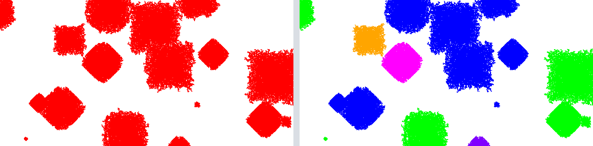
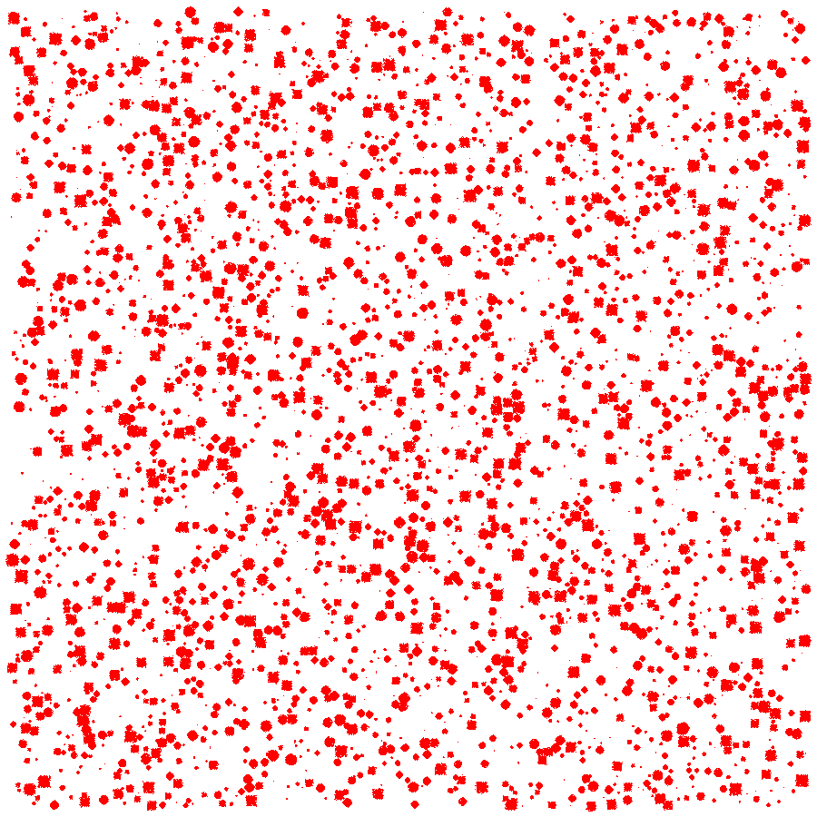
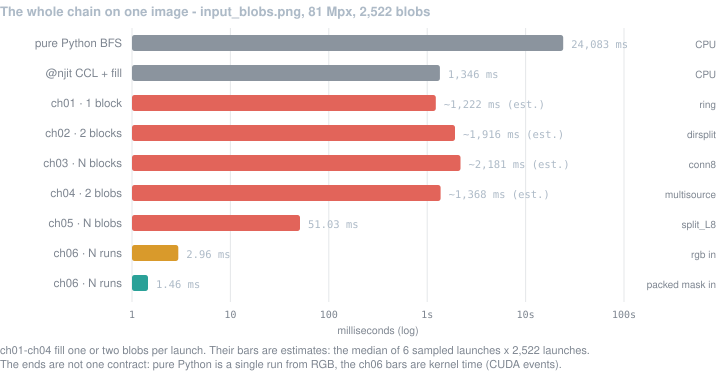
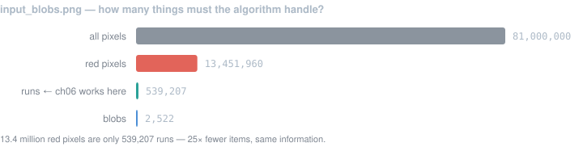
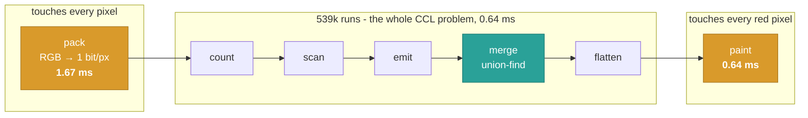
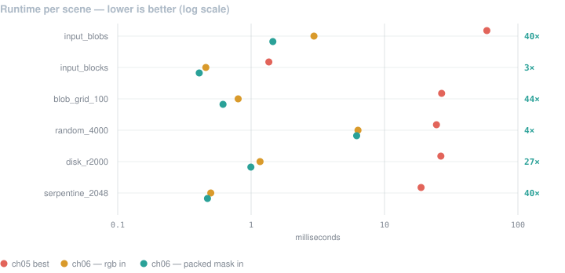
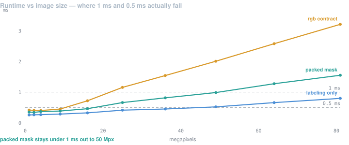

# flood-fill-cuda

Find every red blob in an image and recolor it - on the GPU, in CUDA +
Numba, built up over ten chapters (ch00-ch09) from a sequential CPU BFS.
The last one takes the GPU's ideas back to every CPU core.

Every kernel is pixel-exact against a CPU oracle, and the oracles are
checked against OpenCV. Every number is a committed benchmark JSON,
measured on an RTX 4060 Laptop (24 SMs) and, for ch09, an i9-13900H
under WSL2 (16 vCPUs).

Times are kernel time on the GPU (CUDA events) unless a line says
otherwise: the copies to and from the GPU are not in them.
[Against the libraries](#against-the-libraries) sets the project beside
OpenCV and CuPy, copies included.

**The real story:
[`chapters/README.md`](src/flood_fill_cuda/chapters/README.md)** - a
living document: inherited problems → approaches tried → measured
results → new problems exposed.



*A crop of `input_blobs.png` (left, a synthetic test image) and what
ch06's kernel returns for it (right). The recolor ran on the whole
81 Mpx image - 2,522 blobs, **1.46 ms** from a packed mask, 2.96 ms
from RGB. That is kernel time on the GPU (CUDA events): the copies to
and from the GPU are not in it. Colours repeat every 6 blobs: the label
map, not the paint, is ground truth.*

---

## The chain

Each chapter answers a weakness that an earlier chapter **measured**.


The highlighted chapters are the best today, each for its own job
([below](#what-is-best-for-which-job)).

## The chapters

| # | Question | What it built | Headline |
|---|---|---|---|
| **0** | Where to start? | Pure-Python BFS, an `@njit` level-synchronous BFS (the oracle, kept in ch01's `cpu_oracle.py`), a broken GPU prototype | The oracle every kernel must match pixel for pixel |
| **1** | One core is serial | Level-synchronous BFS in one block; shared-memory ring + global spill tier | 2.03× the CPU at 36 Mpx |
| **2** | One SM is 4% of the GPU | Two blocks, three ways to split the work | 2.10× ch1; the plainest design won |
| **3** | Does it keep scaling? | N co-resident blocks, grid-wide barriers, 8-connectivity | 64 Mpx in 100 ms; plateau found at 512 threads/SM |
| **4** | One blob is one BFS | Two blobs in one launch, labels inside the queue entry | 1.05-2.05× vs two sequential launches |
| **5** | Who finds the seeds? | Seedless discovery: candidate waves + atomicMin union-find | **755,577 blobs in 24.8 ms**, one launch, zero seeds |
| **6** | Why move pixels at all? | Runs, not pixels - run-table connected components | **58 ms → 2.96 ms** on the 81 Mpx image, RGB in (1.46 ms from a packed mask) |
| **7** | One pixel per step? | One blob, a BFS over 32×32 tiles closed in registers | `sq_8000` (64 Mpx) in **3.107 ms**, 22.7× ch03's best grid |
| **8** | Many blobs on tiles? | Tile components as BFS nodes: waves, one union pass, a dense-tile path | `input_blobs` in **2.403 ms**, 0.890 of ch06's time (per-round median, `dense_20261016T054922Z`); 0.982 once ch06 has ch08's pack kernel |
| **9** | Was one core fair? | ch03, ch07 and ch08's ideas on all 16 vCPUs: `prange`, no atomics | **21.29 ms** on the 64 Mpx square, 51× one core; GPU 6.24× by events, CPU 1.89× with copies |

<p align="center">
  
</p>

*Chapter 5 filling `input_blobs.png` - all 2,522 blobs discovered and
flooding at once, each in its own colour, from a single launch with no
seeds given. This is a replay of the recorded depth map (5 MB, 75
frames). Chapter 6 has no such picture, and that is the point: it is not
a BFS, so there is no wavefront to record.*

### Every stage on the same image



`input_blobs.png` is the one picture every stage was asked to do. The
chart shows orders of magnitude. It is not one like-for-like ratio.

Three things to read it with:

- **The two ends are different contracts.** The pure-Python bar is a
  single run from RGB on the host clock (24.1 s). The ch06 bars are
  kernel time on the GPU. One over the other is 16,551×, a number that
  sets an interpreter against a kernel clock. The like-for-like pair is
  ch09's, in one session (`ch09_20261017T233237Z`): one CPU core takes
  271.5 ms and the GPU 2.23 ms by events (122×), or 49.3 ms with the
  copies in and out (5.5×). Sixteen threads take 21.06 ms.
- **ch01-ch04 look slow here on purpose, and their bars are estimates.**
  They are seeded single- or two-blob kernels, so a 2,522-blob image
  costs them one launch *per blob*. The overview session timed a sample
  of 6 blobs and multiplied the median launch by 2,522 (1,261 pairs for
  ch04): what using that stage would cost, to the precision of that
  sample. It is also why ch02 and ch03 sit *above* ch01 - more blocks
  per launch does not help when the launch itself is the unit being
  repeated 2,522 times.
- **The ch06 bars come from a different session** than the rest (±8%
  clock spread on this laptop). The smallest gap on the chart, ch05 to
  ch06 from RGB, is 17×, so it cannot change a conclusion.

The chart stops at ch06. ch08 and ch09 time the same image in their
own sessions (below).

---

## What is best for which job

No chapter is best at everything. Each number comes from the session
named beside it.

| job | best today | measured |
|---|---|---|
| fill one blob on the GPU, as a BFS | **ch07**, a frontier of 32×32 tiles | `sq_8000` in 3.107 ms, 22.7× ch03's best grid (`tiles_20261016T064724Z`) |
| label many blobs on the GPU, as a BFS | **ch08**, waves over tile components | `input_blobs` in 2.403 ms, ch06 2.567 ms; per round, ch08 takes 0.890 of ch06's time (median, `dense_20261016T054922Z`) |
| the non-BFS reference | **ch06**, run-based connected components | no frontier at all; it still beats ch07 and ch08 on some scenes (below) |
| the CPU | **ch09**, tiles on all 16 vCPUs | the 64 Mpx square in 21.29 ms (51× one core), the 81 Mpx frame in 21.06 ms (`ch09_20261017T233237Z`) |

ch06 takes `sq_8000` in 2.252 ms. There ch07's default runs at 0.73×
its speed (paired median, `tiles_20261016T064724Z`).

ch06 also beats ch07 on the serpentines and the maze, in the same
session.

Against ch08's default (`dense_20261016T054922Z`), ch06 wins on long
shapes along tile borders and on `input_blocks`. ch08 takes 1.546× its
time on `zz_lattice_4k` and 1.459× on `input_blocks`.

On images up to about 2000 × 2000 px, ch06 is faster than ch08 or
ties.

Most of ch08's 0.890 on `input_blobs` is its pack kernel (1.18 ms
against ch06's 1.45). Given that pack, ch06 takes 2.402 ms and ch08 is
at 0.982 of it (0.960-1.001 over the rounds): a tie. The labelling
alone, with no pack and no paint, is where the waves lead: 0.408 ms
against 0.505 (0.807).

ch09 also compares the CPU with the GPU, in one session. There ch07
takes the square in 3.411 ms, not the 3.107 above.

By events, ch07 and ch08's first version are still 6.24× and 9.43×
faster.

With the image starting in host memory, the GPU's copies change the
verdict: the CPU wins both big scenes, by 1.89× and 2.34×. One-tile
fronts like the serpentine stay the CPU's at any thread count.

The whole story, chapter by chapter, is in
[`chapters/README.md`](src/flood_fill_cuda/chapters/README.md).

---

## Against the libraries

Chapters 1-9 compare the GPU with code written here. This is the same
work done by OpenCV (`cv2.connectedComponents`) and CuPy
(`cupyx.scipy.ndimage.label`), in one session with ch06, ch08 and ch09
(`libs_20261125T140827Z`, ch09's policy: full GPU clocks, an idle gate,
every output checked against the oracle).

`input_blobs`, 81 Mpx, 2,522 blobs, 8-connectivity. Each column is one
contract; numbers compare only inside a column.

| | mask in, label map out | RGB in, label map out |
|---|---|---|
| the one-core BFS of chapters 1-8 (the oracle) | - | 309.0 ms |
| OpenCV, 1 thread | 119.5 ms | 174.9 ms |
| OpenCV, 16 threads | 59.34 ms | 109.7 ms |
| **ch09** (CPU), 1 thread | - | 146.0 ms |
| **ch09** (CPU), 16 threads | - | 38.42 ms |
| CuPy (GPU) | 15.10 ms | 22.43 ms |
| **ch06** (GPU) | 2.784 ms | - |
| **ch08** (GPU) | **2.487 ms** | **3.639 ms** |

A label map is a full int32 image, 324 MB here. The project's own
contracts recolour in place and write none, which is why they are
faster (ch08: 2.242 ms from RGB, 1.048 ms from a packed mask, in this
session).

What the table says:

- **Against a GPU library.** ch08 is 6.1× faster than CuPy from a mask
  and 6.2× from RGB.
- **Against OpenCV on every thread.** ch08 is 24× faster from a mask
  and 30× from RGB, in GPU time.
- **With the copies.** From a host image to a host label map through
  ch08 takes 59.98 ms (pageable copies in and out). That is 1.8× faster
  than OpenCV on 16 threads, and 1.6× *slower* than ch09's 38.42 ms.
  The CPU chapter wins when the data starts and ends in host memory.
- **The CPU chapter against OpenCV.** ch09 on 16 threads is 2.9× faster
  than OpenCV on 16; on one thread, 1.2×.
- **The old baseline.** The one-core BFS that chapters 1-8 measure
  against is 1.8× slower than OpenCV's one thread on this image, and
  6.7× slower on the solid square. A "× the CPU" from those chapters is
  against that BFS, not against the best CPU code.

The other scenes of the session, same two contracts where a cell has
them (mask in / RGB in, label map out):

| scene | OpenCV 16 threads | ch09 16 threads | CuPy | ch06 | ch08 |
|---|---|---|---|---|---|
| `sq_8000`, 64 Mpx, one blob | 48.36 / 88.10 ms | - / 39.35 ms | 17.29 / 22.94 ms | 2.357 ms / - | 2.738 / 3.722 ms |
| `random_4000`, 16 Mpx, 755,577 blobs | 16.33 / 24.83 ms | - / 27.63 ms | 7.342 / 8.758 ms | 6.033 ms / - | 2.315 / 2.551 ms |
| `input_blocks`, 1 Mpx, 21,618 blobs | 0.372 / 1.154 ms | - / 0.735 ms | 0.993 / 1.246 ms | 0.176 ms / - | 0.183 / 0.207 ms |

Where the project loses or only ties:

- On the noise scene OpenCV on 16 threads (24.83 ms from RGB) beats
  ch09 (27.63 ms), and on one thread it is twice as fast (84.65 against
  173.0 ms). Not profiled.
- On the noise scene ch06 (6.033 ms) is barely ahead of CuPy (7.342 ms).
- On the 1 Mpx image the copies decide: ch08 end to end takes 1.61 ms,
  OpenCV 1.154 ms from RGB and ch09 0.735 ms.
- ch06 beats ch08 on the solid square (2.357 against 2.738 ms).

One laptop, one GPU, one session. Rerun it with:

```bash
uv run python -m flood_fill_cuda.chapters.ch09_cpu_nthreads.benchmarks.library_baselines
```

---

## Chapter 6 - runs, not pixels

Chapters 1-5 optimize *how* pixels move. Chapter 6 changes **what moves**.
Chapters 7 and 8 bring the BFS back on tiles; ch06 stays the non-BFS
reference they are measured against.

A **run** is a maximal red span inside one row. `input_blobs.png` is
9000 × 9000, and this is the whole idea:



**25× fewer things to work with.** Connectivity, labels and the paint
spans are all facts about *runs*, so the whole connected-components
problem shrinks to 539k items - and the clock collapses onto the only
two things that still touch pixels: one read, one write.

### The pipeline

Six plain kernels, stream-ordered. No cooperative launch, so no
residency cap:



Two phases are the runtime. Everything between them - finding the runs,
merging them, naming all 2,522 blobs - is 0.64 ms.

### Results - same image, same session

| | time | vs ch05 |
|---|---|---|
| ch05 best (`split_L8`) | 58.51 ms | - |
| **ch06, RGB in** (recolored in place) | **2.96 ms** | 19.8× |
| **ch06, packed 1-bit mask in** | **1.46 ms** | 40.2× |
| ch06, labeling only (nothing painted) | 0.78 ms | - |

The rows are not one contract. ch05's clock also writes a label and a
depth for every pixel; ch06's rows write the 6-colour paint and no
label map. "RGB in" is the like-for-like row. With a full int32 label
map written, ch06 takes 2.784 ms from the packed mask
(`libs_20261125T140827Z`).



Shape also stopped mattering - the serpentine that cost ch03 32,641 BFS
levels now costs one merge pass:

| scene | ch05 | ch06 (mask) | speedup |
|---|---|---|---|
| serpentine 2048² | 18.79 ms | 0.47 ms | 39.9× |
| disk r=2000 | 26.43 ms | 1.00 ms | 26.5× |
| 100-blob grid | 26.80 ms | 0.62 ms | 43.5× |
| percolation noise (1.4 px/run) | 24.50 ms | 6.18 ms | 4.0× |

### The wall - and where 1 ms actually is

Reading 243 MB of RGB costs **1.14 ms** at the measured peak. So nothing
recolors this image from RGB in under a millisecond. Not the algorithm -
arithmetic.

Measured on *crops* of the real image - a crop keeps the run length, red
fraction and blob sizes intact, where a resize would change all three:



| tier | ≤ 1 ms up to | ≤ 0.5 ms up to |
|---|---|---|
| RGB contract | 21.9 Mpx | 10.4 Mpx |
| packed mask | **49.8 Mpx** | 17.9 Mpx |
| labeling only | the whole sweep | 45.6 Mpx |

The flat left end below ~4 Mpx is not the image - it is the six kernel
launches (0.33 ms of host enqueue). CUDA graphs, not a better algorithm,
is what would move it.

### Results that were thrown away

Each killed a theory that sounded airtight:

- **Word stores instead of byte stores** - no difference (64 vs 61 GB/s).
  The paint is scatter-bound, not store-bound.
- **Skipping color channels that don't change** - *slower* (0.750 vs
  0.665 ms). The branch costs more than the store it skips.
- **One block per image row** - 2.4× slower. 324,000 tiny blocks;
  dispatch outweighs the memory traffic.

### Two instrument bugs it exposed

Both retroactively explain five chapters of "timing noise":

- `counters.copy_to_device()` is a **synchronous** numba H2D copy. Once
  per run it turned six async launches into six host-blocked round trips:
  1.72 ms of host time, more than the whole GPU pipeline. *The clock
  was measuring Python.*
- **This GPU idles at ~700-1470 MHz of 3105** and won't spin up for a
  millisecond kernel. Cold: 2.27 ms. Hot: 1.37 ms. Benchmarks now spin
  the clock up first and record what they achieved.

---

## Triton twins - the same chapters, in Triton

Every Numba kernel of chapters 0-6 has a Triton twin: same algorithm,
same tests, same host API. A harness times both on the same cells and
compares their deterministic outputs on every run.

| measure | result |
|---|---|
| rows timed | 1,214, deterministic outputs identical on every run |
| `kernel_ms`, Numba / Triton (host launch path included) | **x1.12** overall (above x1 = Triton faster); about x1.07 with GPU-only time where it was measured |
| where Triton still trails | ch05 (x0.87) and the ch00 prototype (x0.90) |
| the first, faithful translation | x0.91: two translation choices lost it (each a workaround for a construct Triton lacks), not Triton's code generation |

**The report: [`triton_twins/README.md`](src/flood_fill_cuda/triton_twins/README.md)**

---

## Quickstart

```bash
uv sync
uv run pytest                              # 9,292 tests collected
uv run python -m flood_fill_cuda.dashboard # dashboard: ch01-ch06 and the Triton twins
```

The 9,292, by folder (a collect-only run on 2026-11-25): ch01 48, ch02
102, ch03 139, ch04 75, ch05 208, ch06 121, ch07 2,223 (247 tests in
each of 9 switch modes), ch08 2,567, ch09 632, Triton twins 3,027,
service 55, overview 11, shared 84.

They are 802 test functions: most of the count is one function run
over many scenes and kernel configurations.

ch01-ch08, the Triton twins and the service need the GPU. The
overview's 11 and shared's 84 (the oracles against OpenCV) are CPU
only. ch09's 632 run on the CPU too (its GPU side is faked):

```bash
nice -n 10 uv run pytest src/flood_fill_cuda/chapters/ch09_cpu_nthreads/
```

One chapter's benchmark + its dashboard section:

```bash
uv run python -m flood_fill_cuda.chapters.ch06_gpu_nblob_runs.benchmarks.benchmark
uv run python -m flood_fill_cuda.chapters.ch06_gpu_nblob_runs.benchmarks.scaling
```

The one-page overview (abstract, glossary, and the grand table - every
approach × every shape × scale) is [`site/index.html`](site/index.html).
It covers the CPU and chapters 1-5; the later chapters are not in its
session yet:

```bash
uv run python -m flood_fill_cuda.overview.bench    # ~5-10 min GPU session
uv run python -m flood_fill_cuda.overview.build
```

The project page, in the style of the Nerfies page, with the chapter
clips, two scrub sliders and the explainer video, is
[`project-page/index.html`](project-page/index.html). Open it in a
browser; [`project-page/README.md`](project-page/README.md) explains how
to rebuild and publish it.

> **Never** run a benchmark and the web service at the same time, and
> never `--workers > 1`. Concurrent cooperative launches wedge the GPU
> under WSL2.

---

## Layout

```
src/flood_fill_cuda/
  chapters/     the numbered narrative: ch00_cpu_baseline .. ch09_cpu_nthreads
  shared/       scene generators, CPU oracles, bandwidth model, plot core
  dashboard/    assembles every chapter's section into one page
  service/      interactive demo app (not part of the benchmark chain)
  overview/     the one-page grand table
  experiments/  live side-tracks (triton/, scan_multi_blob/)
  triton_twins/ chapters 0-6 rebuilt in Triton, plus the Numba-vs-Triton harness
  results/      generated JSON/CSV/HTML + wavefront renders, one folder per chapter
graveyard/      superseded code, kept for reference
```

Each chapter folder holds its kernel, its CPU-matching test suite, and a
`benchmarks/` subfolder that measures it and renders its own dashboard
section.

---

## How to trust the numbers

- **Pixel-exact.** Every kernel is checked against a compiled CPU oracle:
  visited maps, depth maps, label maps, blob counts, and each blob's
  canonical seed. Not just pixel totals. ch06 is also checked at the
  size it is measured at (81 Mpx).
- **The oracles have an outside anchor.** All four are compared with
  OpenCV's `connectedComponents` and with a BFS written as array
  dilations (`shared/test_oracles_vs_opencv.py`), on both benchmark
  images at full size.
- **What is timed.** GPU numbers are kernel time between CUDA events,
  with the image already on the GPU. A line that includes the copies
  says "end to end". A number is compared only with numbers of the same
  input and output contract.
- **The inputs are in the repo.** `images/input/` holds the two
  benchmark images with their checksums.
- **Same session, interleaved.** A/B comparisons re-measure the baseline
  in the same session and alternate the order, because run-to-run spread
  reaches 73% of the median on this laptop.
- **Losses reported.** Where the CPU wins, the tables say so.
- **Committed.** Every figure quoted here has a timestamped JSON in
  `results/`.

## License

The code, the tests and the results are under the MIT license: see
[LICENSE](LICENSE).

Two parts are not:

- `project-page/` is adapted from the Nerfies page and stays under
  CC BY-SA 4.0. Its bundled files are listed in
  [project-page/THIRD_PARTY_NOTICES.md](project-page/THIRD_PARTY_NOTICES.md).
- The video opens and closes on drone-show footage by a third party.
  The page's copy of the video
  (`project-page/static/videos/explainer.mp4`) carries it, and neither
  license covers it.
